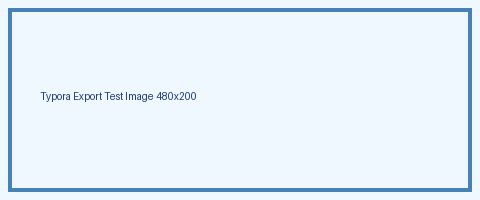

# Heading 1

## Heading 2

普通段落，包含 **粗体**、*斜体*、`inline code`、[链接](https://example.com)。

> blockquote 引用
> 第二行

- list
- list
- list

1. ordered
2. ordered

| A | B |
|---|---|
| 1 | 2 |

```cpp
#include <bits/stdc++.h>
int main() { return 0; }
```

行内公式 $E = mc^2$，下面是一段行间公式：

$$
\sum_{i=1}^{n} i = \frac{n(n+1)}{2}
$$



---

分页测试内容。
